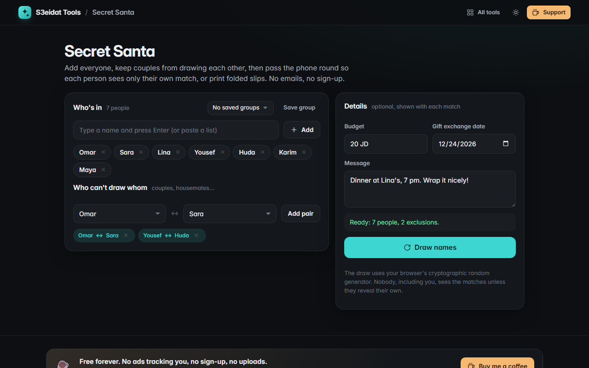

# Secret Santa

> Draw names fairly, with no emails and no sign-up. Free, private, and it runs entirely in your browser.

### ▶ [Open Secret Santa](https://s3eidat.github.io/secret-santa/)



## Features

- Add people one by one or **paste a whole list** (one per line or comma-separated)
- **Exclusions**: pairs who must not draw each other (couples, housemates), in both directions
- **Fair, crypto-random draw** (`crypto.getRandomValues`): nobody draws themselves or an excluded partner; random permutations are sampled until one fits, with a bounded number of tries and a backtracking fallback for tight groups
- **Explains impossible setups** in plain words, e.g. "A can't draw anyone", or which exclusion to remove to make it work
- **Budget, exchange date and a message** shown with every match
- **Pass the phone**: each person taps their name, confirms, sees only their own match, then hides it; ticks show who has looked
- **Printable folded slips**: name on the outside, match inside; matches are blurred in the on-screen preview and only appear on paper
- **Nothing is stored** unless you press "Save group" (names, exclusions and details, never the draw)

## Privacy

Names never leave your device. There is no server, no account, no analytics.
The page ships with a strict Content-Security-Policy (`connect-src 'self'`), so the browser
itself blocks any attempt to send data anywhere.

## Run it yourself

It's plain HTML, CSS and JavaScript with no build step:

```bash
git clone https://github.com/s3eidat/secret-santa
cd secret-santa
python -m http.server 8000
```

Then open http://localhost:8000.

## Support

If this saved you time, **[buy me a coffee ☕](https://s3eidat.github.io/coffee/)**. It keeps every tool free.

---

Part of **[S3eidat Tools](https://s3eidat.github.io/)**: 100+ free, private tools that run in your browser. MIT licensed.
